<p align="center">
  <a href="https://commons.wikimedia.org/wiki/File:Blogger_icon.svg">
    
  </a>
</p>

<h1 align="center">Blogger Superpowers</h1>

<p align="center">
  <a href="SKILL.md"></a>
</p>

<p align="center">
  <a href="#claude"></a>
  <a href="#other-ai-agents"></a>
</p>

<h3 align="center">Your ideas deserve more than a default theme.</h3>

**Blogger Superpowers is a skill that turns a conversation into a Blogger theme.** You tell your AI assistant about your blog, it asks you simple questions about the look you want, and it hands you one `.xml` file to upload in Blogger. No design vocabulary and no coding are needed.

## Quick start

1. **Install the skill** in your project folder ([other agents](#install)):
   
   ```bash
   git clone https://github.com/anthonyfuar/blogger-superpowers.git .claude/skills/blogger-superpowers
   ```

2. **Start it** in Claude Code:
   
   ```text
   /blogger-superpowers
   ```

3. **Answer the questions.** Pick a number, write your own answer, or say “surprise me.”

4. **Upload the `.xml`** you receive in Blogger: **Theme → ▾ next to Customize → Restore**. [Full steps](#put-the-theme-on-your-blog).

## How it works

The skill is a set of plain Markdown instructions that your assistant follows in seven stages. You only take part in the second one.

| Stage        | What the assistant does                                                                                                   | What you do |
| ------------ | ------------------------------------------------------------------------------------------------------------------------- | ----------- |
| 1. Discover  | Works out whether this is a new theme, an edit, or a repair, and reads your existing theme if you gave one.               | Nothing     |
| 2. Interview | Asks about your project, audience, style, colors, fonts, sections, icons, and movement, two or three questions at a time. | Answer      |
| 3. Design    | Turns your answers into an internal design plan: exact colors, type, spacing, layouts for each kind of page.              | Nothing     |
| 4. Resources | Picks only the fonts, icons, and animation libraries your choices call for.                                               | Nothing     |
| 5. Build     | Writes the complete Blogger theme: real posts, comments, pagination, search, labels, and editable areas.                  | Nothing     |
| 6. Verify    | Checks the file's structure and, when it has a browser, previews it on desktop and phone sizes.                           | Nothing     |
| 7. Deliver   | Gives you **one named `.xml` file** and a short note on what was checked and how to install it.                           | Upload it   |

There is no fixed number of questions. A simple idea moves quickly; an ambitious one gets the follow-ups it needs. You can say “skip” or “recommend one” at any point.

## Install

One command, run from your project folder. It needs only Git. The skill is Markdown files.

### Claude

```bash
git clone https://github.com/anthonyfuar/blogger-superpowers.git .claude/skills/blogger-superpowers
```

Then type `/blogger-superpowers`. If it does not appear, start a new session.

### Other AI agents

Codex, Gemini and any other assistant that can read files:

```bash
git clone https://github.com/anthonyfuar/blogger-superpowers.git .agents/skills/blogger-superpowers
```


### Create a new theme

```text
/blogger-superpowers
```

That is all you need. The skill asks about your business, brand, or personal project, what you offer or write about, who you want to reach, and what visitors should do. Then it guides you through style, sections, colors, fonts, icons, and animations. You do not need to prepare a prompt or a design brief.

### Edit a theme you already have

First download your current theme from Blogger: **Theme → ▾ next to Customize → Backup → Download**. Then give the skill its location:

```text
/blogger-superpowers Edit my current theme at /path/to/MyTheme.xml
```

The skill reads your theme, asks what you want to change, and follows up only on the details it needs. Your original file is left untouched and you receive a revised `.xml`.

### Ask for one snippet

```text
/blogger-superpowers Give me only a snippet that shows the reading time on each post
```

You get that piece of code and the exact place to paste it, without the interview or a whole new theme.


## Put the theme on your blog

1. **Back up first.** In Blogger, open **Theme**, click the **▾** next to **Customize**, choose **Backup**, and download your current theme.
2. **Upload.** In the same menu choose **Restore**, then **Upload**, and select the new `.xml` file.
3. **Check it.** Open your homepage, a post, a page, a label, and a search on both a computer and a phone. Leave a test comment.
4. **Show it on phones.** In the same **Theme** menu open **Mobile settings** and choose **Desktop**. The theme is responsive and adapts by itself; Blogger's separate mobile theme would replace it on phones.
5. **Edit your content** in **Layout**, and colors in **Customize** where the theme offers them.
6. **Undo if needed.** Choose **Restore** again and upload the backup from step 1.

Blogger's menu names can change. If you have a second blog, try the theme there first.

## Examples.

These examples were created through the skill's workflow, with the assistant choosing the interview answers for each concept. Different niches, compositions, typography, palettes, sections, artwork, and motion, not the same theme in different colors.

**Click a preview to see the complete page. Click a theme name to open its XML.** . The examples are showcase only: they play no part in how your theme is made.

<table>
<tr>
<td width="25%" valign="top">
<a href="examples/01-form-and-field/full-page.png">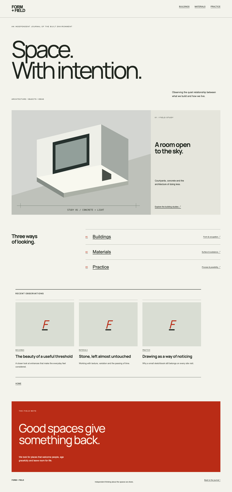</a><br>
<b>01 · <a href="examples/01-form-and-field/FormAndField.xml">Form and Field</a></b><br>
Architecture and spatial design<br>
<sub>A precise Swiss architectural journal in concrete, vermilion and generous white space.</sub>
</td>
<td width="25%" valign="top">
<a href="examples/02-the-patient-garden/full-page.png">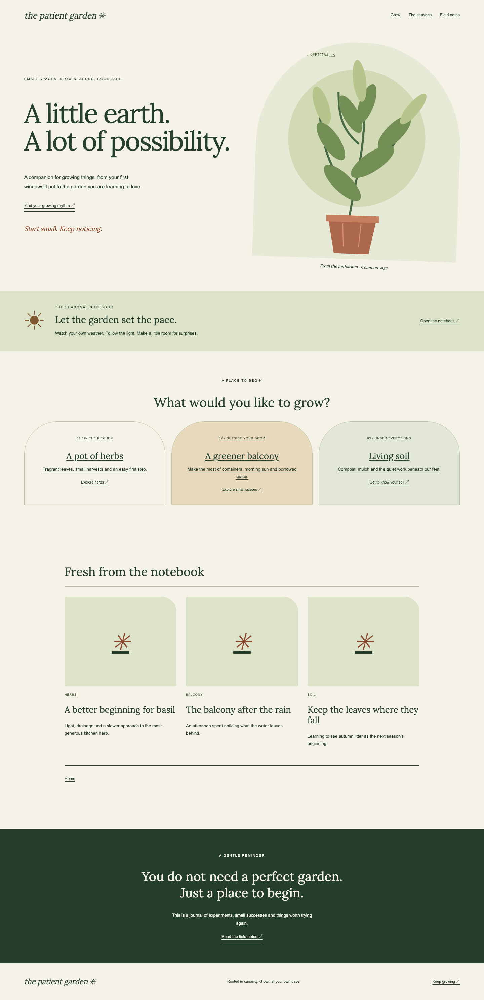</a><br>
<b>02 · <a href="examples/02-the-patient-garden/ThePatientGarden.xml">The Patient Garden</a></b><br>
Slow gardening and balcony growing<br>
<sub>A gentle illustrated field guide with sage greens, clay details and seasonal growing notes.</sub>
</td>
<td width="25%" valign="top">
<a href="examples/03-still-form/full-page.png">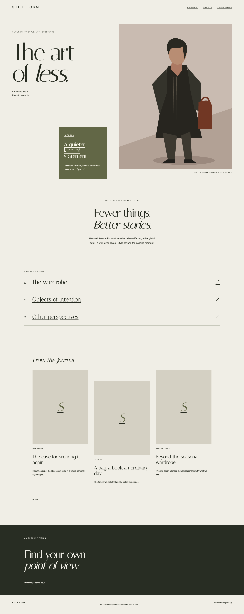</a><br>
<b>03 · <a href="examples/03-still-form/StillForm.xml">Still Form</a></b><br>
Independent fashion and considered wardrobes<br>
<sub>An asymmetric luxury editorial with oversized serif type, olive tailoring and restrained motion.</sub>
</td>
<td width="25%" valign="top">
<a href="examples/04-common-ground/full-page.png">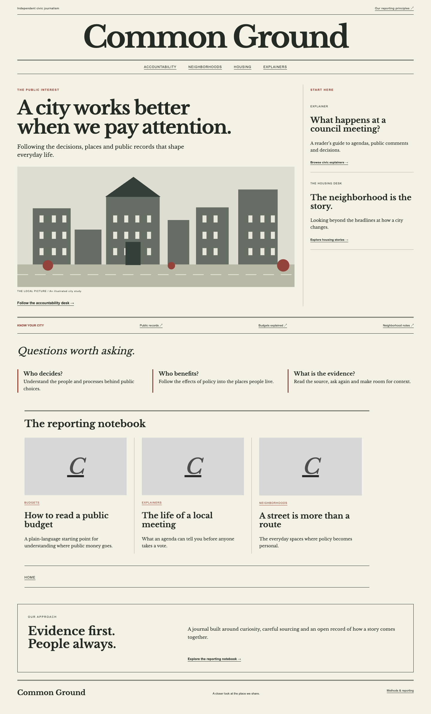</a><br>
<b>04 · <a href="examples/04-common-ground/CommonGround.xml">Common Ground</a></b><br>
Civic reporting and local accountability<br>
<sub>A newspaper-inspired civic journal with dense editorial hierarchy, columns and practical public-interest guides.</sub>
</td>
</tr>
<tr>
<td width="25%" valign="top">
<a href="examples/05-the-lamplit-page/full-page.png">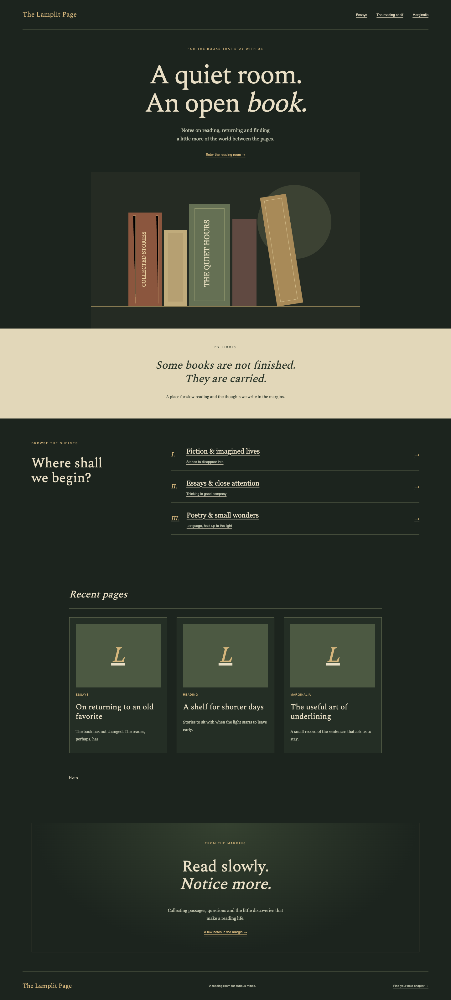</a><br>
<b>05 · <a href="examples/05-the-lamplit-page/TheLamplitPage.xml">The Lamplit Page</a></b><br>
Literature and reading journals<br>
<sub>A dark academia reading room with clothbound book art, brass rules and generous literary typography.</sub>
</td>
<td width="25%" valign="top">
<a href="examples/06-far-and-familiar/full-page.jpg">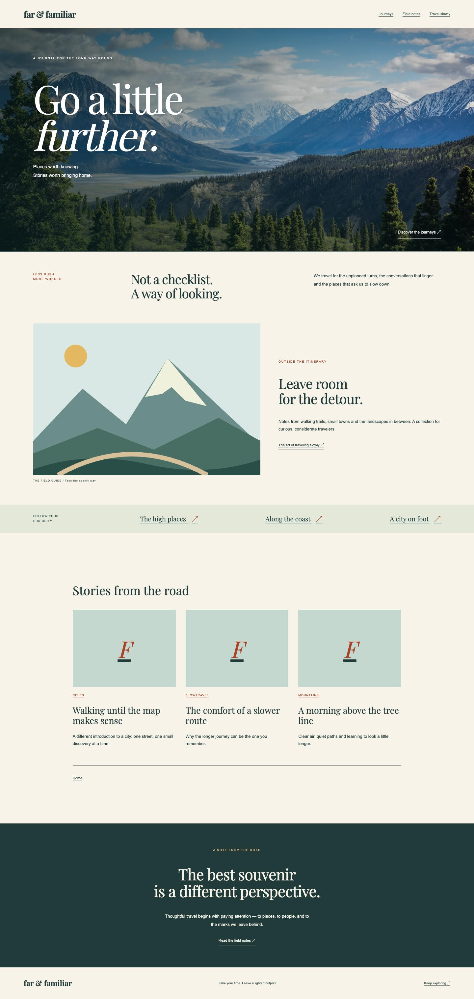</a><br>
<b>06 · <a href="examples/06-far-and-familiar/FarAndFamiliar.xml">Far and Familiar</a></b><br>
Slow travel and landscape journals<br>
<sub>An immersive travel journal with a mountain photograph, original route illustration and gentle desktop parallax.</sub>
</td>
<td width="25%" valign="top">
<a href="examples/07-curb-theory/full-page.png">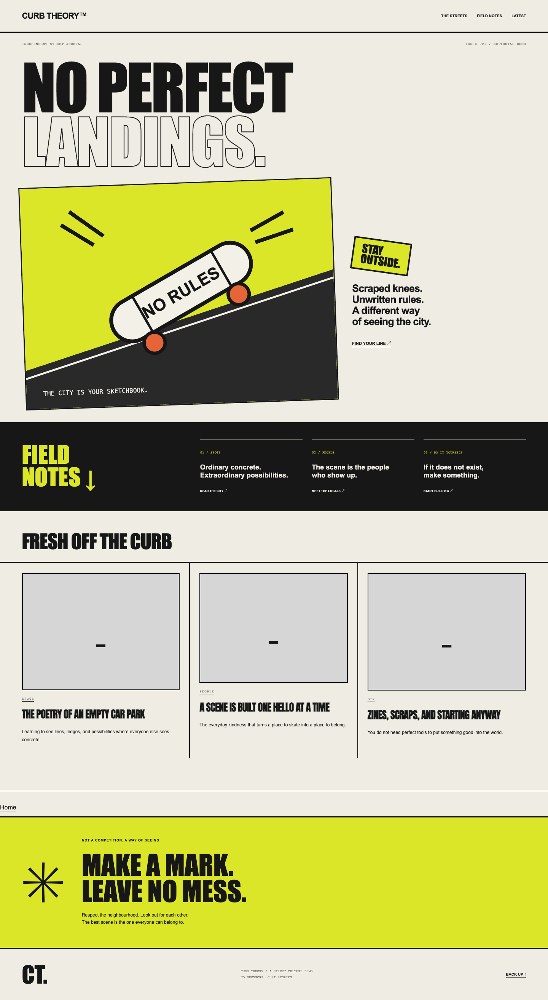</a><br>
<b>07 · <a href="examples/07-curb-theory/CurbTheory.xml">Curb Theory</a></b><br>
Skateboarding and independent street culture<br>
<sub>A raw brutalist street zine with oversized type, skewed deck artwork, field notes and a DIY manifesto.</sub>
</td>
<td width="25%" valign="top">
<a href="examples/08-happy-little-mess/full-page.png">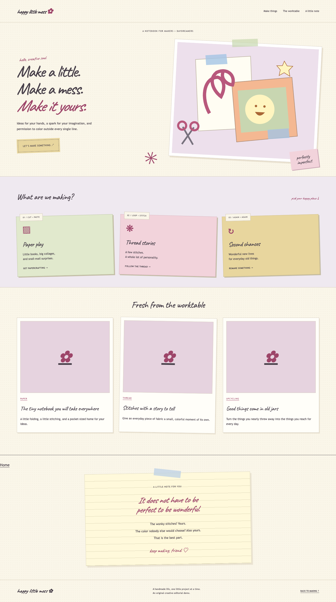</a><br>
<b>08 · <a href="examples/08-happy-little-mess/HappyLittleMess.xml">Happy Little Mess</a></b><br>
Crafts, DIY and handmade journaling<br>
<sub>A colorful scrapbook studio with layered paper, stitched outlines, project tabs and an encouraging makers’ note.</sub>
</td>
</tr>
<tr>
<td width="25%" valign="top">
<a href="examples/09-little-big-why/full-page.png">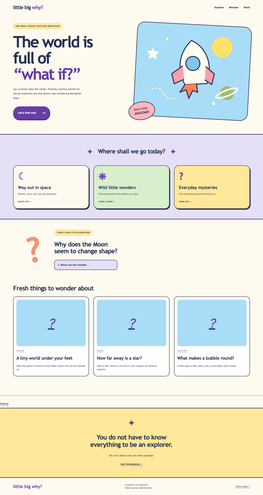</a><br>
<b>09 · <a href="examples/09-little-big-why/LittleBigWhy.xml">Little Big Why</a></b><br>
Children’s science and family discovery<br>
<sub>An illustrated science playground with friendly shapes, topic islands and an expandable wonder question.</sub>
</td>
<td width="25%" valign="top">
<a href="examples/10-offbeat-frequency/full-page.png">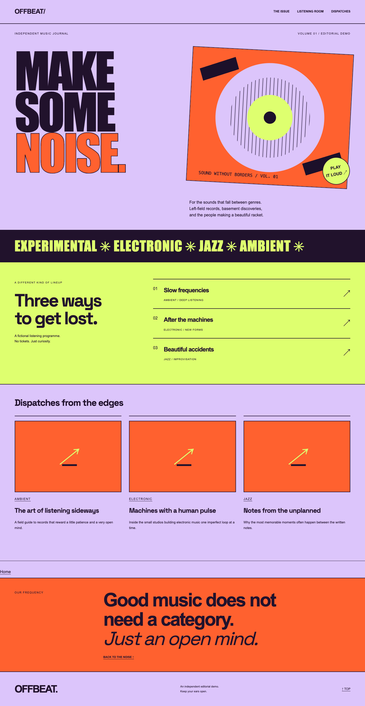</a><br>
<b>10 · <a href="examples/10-offbeat-frequency/OffbeatFrequency.xml">Offbeat Frequency</a></b><br>
Experimental music and festival culture<br>
<sub>A loud typographic music poster with a spinning record illustration, artist index and listening notes.</sub>
</td>
<td width="25%" valign="top">
<a href="examples/11-save-point/full-page.png">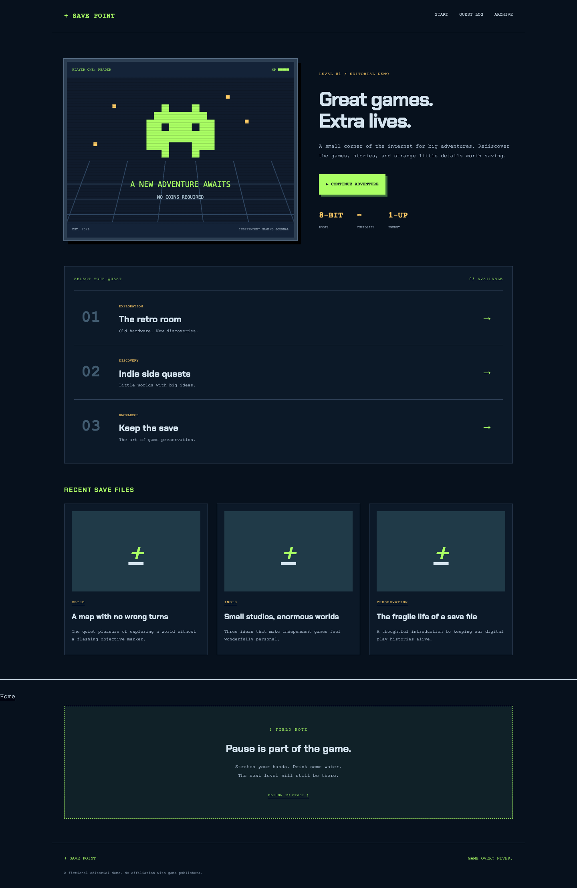</a><br>
<b>11 · <a href="examples/11-save-point/SavePoint.xml">Save Point</a></b><br>
Retro gaming and game preservation<br>
<sub>A navy pixel arcade journal with a console screen, cartridge navigation and numbered quest log.</sub>
</td>
<td width="25%" valign="top">
<a href="examples/12-sun-and-supper/full-page.png">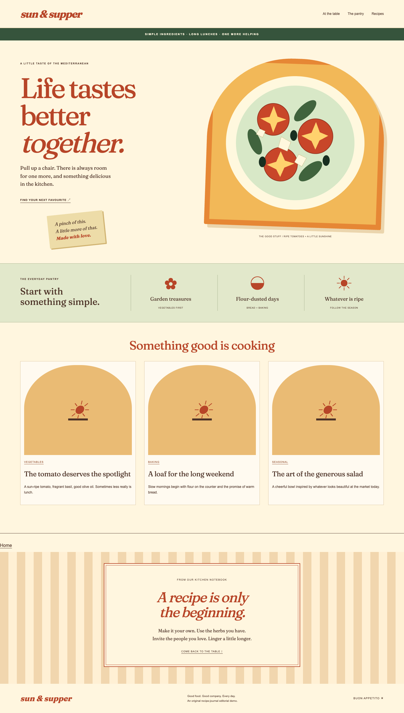</a><br>
<b>12 · <a href="examples/12-sun-and-supper/SunAndSupper.xml">Sun and Supper</a></b><br>
Mediterranean home cooking<br>
<sub>Warm maximalist recipe journal with painted food illustration, scalloped notes and a seasonal pantry.</sub>
</td>
</tr>
<tr>
<td width="25%" valign="top">
<a href="examples/13-patch-notes/full-page.png">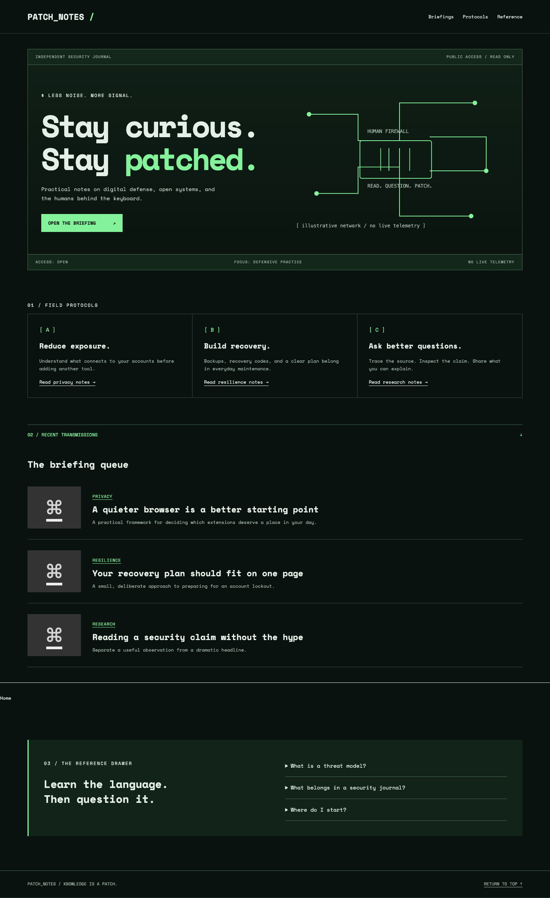</a><br>
<b>13 · <a href="examples/13-patch-notes/PatchNotes.xml">Patch Notes</a></b><br>
Cybersecurity<br>
<sub>A green-phosphor security publication with a terminal masthead, protocol checklist and reference drawer.</sub>
</td>
<td width="25%" valign="top">
<a href="examples/14-nocturne-observatory/full-page.png">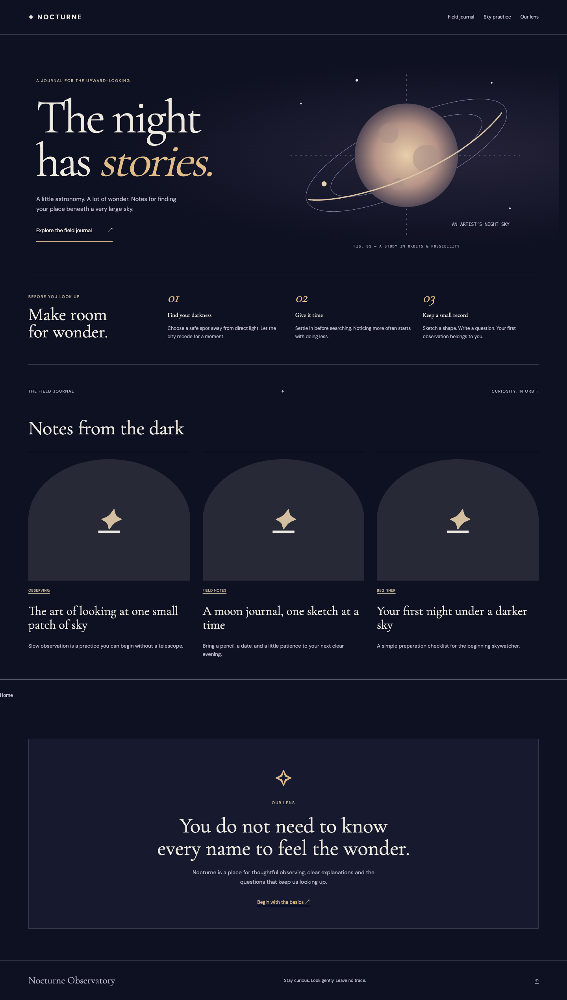</a><br>
<b>14 · <a href="examples/14-nocturne-observatory/NocturneObservatory.xml">Nocturne Observatory</a></b><br>
Astronomy<br>
<sub>A midnight observatory journal with oversized serif type, an orbital drawing and skywatching field cards.</sub>
</td>
<td width="25%" valign="top">
<a href="examples/15-still-room/full-page.png">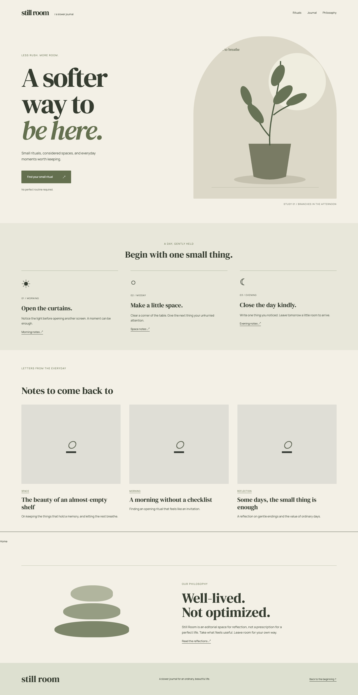</a><br>
<b>15 · <a href="examples/15-still-room/StillRoom.xml">Still Room</a></b><br>
Mindful living<br>
<sub>A quiet Japandi journal with an asymmetrical botanical hero, daily ritual notes and soft editorial columns.</sub>
</td>
<td width="25%" valign="top">
<a href="examples/16-breakaway-journal/full-page.png">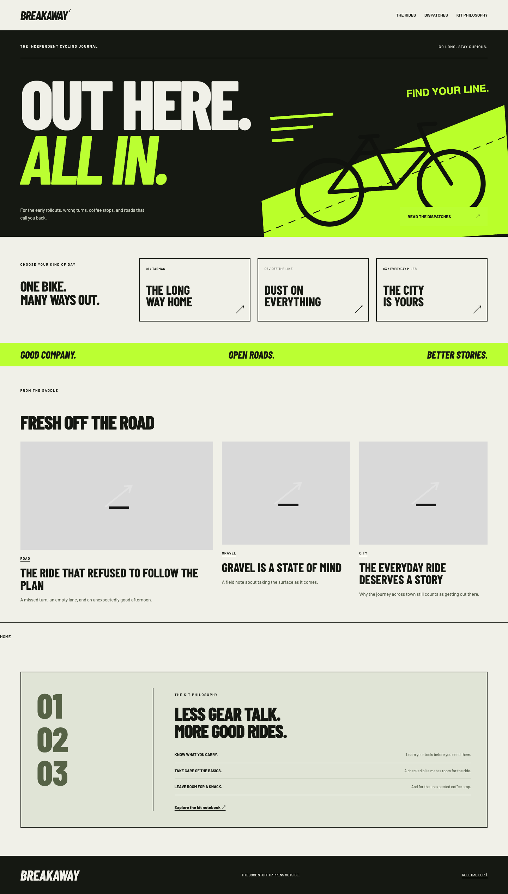</a><br>
<b>16 · <a href="examples/16-breakaway-journal/BreakawayJournal.xml">Breakaway Journal</a></b><br>
Cycling and endurance<br>
<sub>An electric cycling zine with slanted road graphics, route-type tiles, equipment notes and oversized condensed headlines.</sub>
</td>
</tr>
<tr>
<td width="25%" valign="top">
<a href="examples/17-common-cents/full-page.png">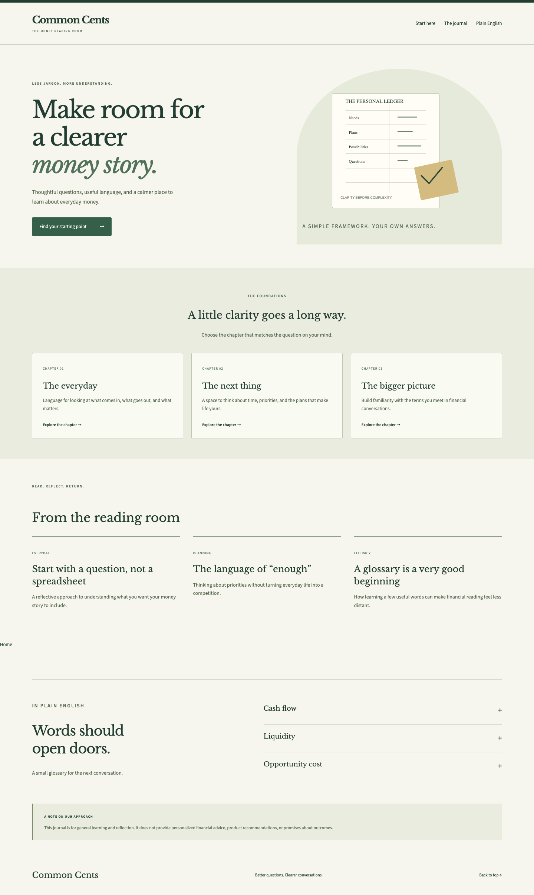</a><br>
<b>17 · <a href="examples/17-common-cents/CommonCents.xml">Common Cents</a></b><br>
Personal finance education<br>
<sub>A trustworthy finance reading room with ledger-inspired illustration, clear learning paths and glossary details.</sub>
</td>
<td width="25%" valign="top">
<a href="examples/18-tidal-notes/full-page.png">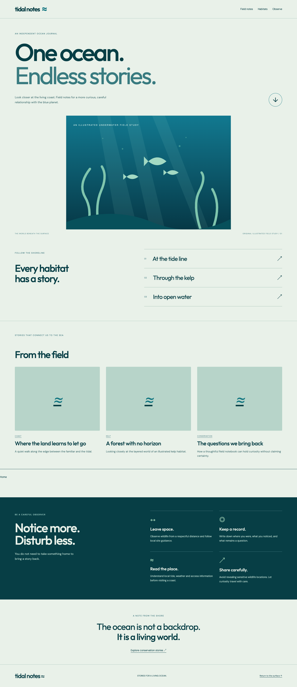</a><br>
<b>18 · <a href="examples/18-tidal-notes/TidalNotes.xml">Tidal Notes</a></b><br>
Ocean conservation<br>
<sub>An immersive ocean field journal with an underwater illustration, habitat index and careful citizen-observation guidance.</sub>
</td>
<td width="25%" valign="top">
<a href="examples/19-kiln-object/full-page.png">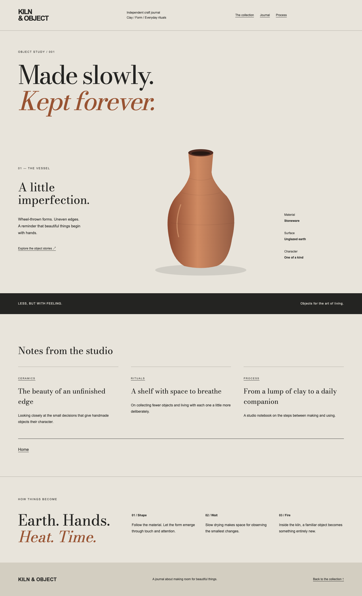</a><br>
<b>19 · <a href="examples/19-kiln-object/KilnObject.xml">Kiln & Object</a></b><br>
Ceramics and independent craft<br>
<sub>A sculptural museum catalogue: oversized object studies, quiet labels and a terracotta process journal.</sub>
</td>
<td width="25%" valign="top">
<a href="examples/20-vow-and-vellum/full-page.png">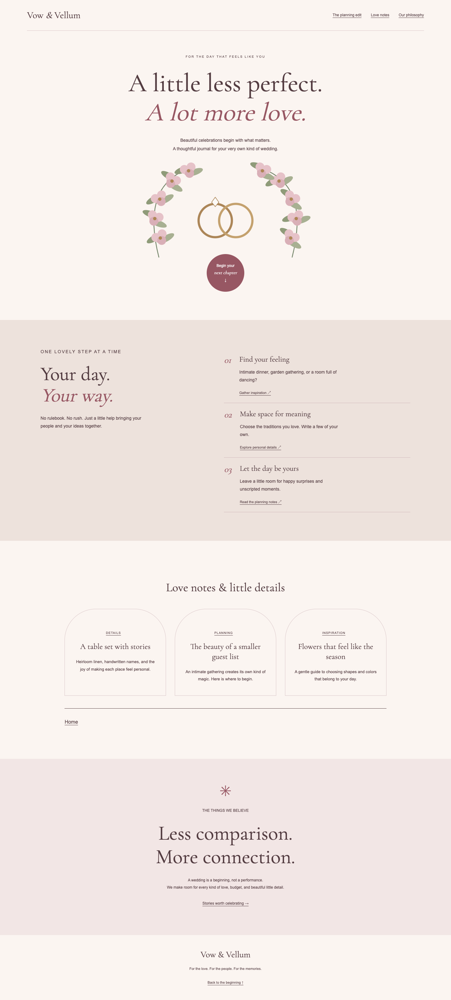</a><br>
<b>20 · <a href="examples/20-vow-and-vellum/VowVellum.xml">Vow & Vellum</a></b><br>
Intimate weddings and celebrations<br>
<sub>A romantic invitation brought to life with ribbon lettering, a floral arch and a thoughtful planning timeline.</sub>
</td>
</tr>
</table>

.

## The questions make it yours

Your assistant first gets to know your project, your audience, and your goals. Then it offers simple choices and follows your answers:

- **Find your look.** Minimalist, brutalist, maximalist, editorial, retro, botanical, playful, futuristic, and more.
- **Set the mood.** Colors, font pairings, light or dark backgrounds, shapes, spacing, and image treatments.
- **Build your pages.** Which sections belong, what comes first, and how people discover your stories.
- **Choose your movement.** Animated icons, gentle entrances, expressive headlines, hover details, parallax, page transitions, and meaningful loading cues, or a beautifully still experience.
- **Make it comfortable.** Phone layouts, readable articles, keyboard navigation, and motion preferences are part of the conversation.

**Your next theme should look like your next idea.**

## Good to know

- **You get one file.** No folders, build steps, or extra assets. Fonts and animation libraries load from public CDNs, so the theme needs an internet connection to show them, and it stays readable without them.
- **Every theme follows Blogger's own rules.** Before writing a theme the assistant reads the skill's Blogger references in full, and the finished file must pass a 36-point check of Blogger's documented syntax, twice, before you receive it.
- **Every theme is responsive.** Phone, tablet, and desktop layouts are part of every theme, with a menu that works by touch and keyboard. You are never asked whether you want it.
- **Effects are real code.** Animations, icons, parallax, backgrounds, 3D, page transitions, and loading cues come from a library of tested recipes written in plain CSS, SVG, and JavaScript, or one pinned CDN file. No React, no build step. A 3D scene of your own needs your Spline scene link; otherwise you get a CSS 3D shape.
- **“Powered by Blogger” is hidden by default** and the theme uses its own favicon. Tell the skill if you want to keep Blogger's attribution.
- **Test before you rely on it.** The assistant checks the file's structure and previews it locally, but only Blogger can confirm that a theme saves and renders correctly. The gallery themes were checked the same way and have not been installed on a live blog by this project.
- **A theme is not a backend.** Contact forms, newsletters, shops, and bookings need a real external service. The skill asks you for it instead of inventing one.


## Resources and creator credits

Thank you to the people who build and maintain these projects. Credits acknowledge the original creators and contributors; they do not imply endorsement.

These are the only third-party projects whose code, files, or format are used by the gallery or the workflow.

| Project                                                           | Creator / team credit                                                                | Where it is used                                                                                                                        |
| ----------------------------------------------------------------- | ------------------------------------------------------------------------------------ | --------------------------------------------------------------------------------------------------------------------------------------- |
| [GSAP](https://gsap.com/)                                         | [GreenSock / Webflow and contributors](https://gsap.com/)                            | GSAP 3.15.0 from a versioned CDN: entrance animations in Kiln & Object, Form and Field, Still Form, Patch Notes, and Breakaway Journal. |
| [Anime.js](https://animejs.com/)                                  | [Julian Garnier and contributors](https://github.com/juliangarnier/anime)            | Anime.js 4.5.0 from a versioned CDN: illustration entrances in Nocturne Observatory and Tidal Notes.                                    |
| [simpleParallax](https://simpleparallax.com/)                     | [Geoffrey Signorato and contributors](https://github.com/geosigno/simpleParallax.js) | simple-parallax-js 7.0.0 from a versioned CDN: desktop photograph parallax in Far and Familiar.                                         |
| [Google Fonts](https://fonts.google.com/)                         | [Google Fonts and the typeface designers](https://github.com/google/fonts)           | Hosted font stylesheets in all 20 examples, with fallback fonts.                                                                        |
| [Google design.md](https://github.com/google-labs-code/design.md) | [Google Labs and contributors](https://github.com/google-labs-code/design.md)        | Workflow only: the format of the skill's internal design plan. Nothing from it ships in a theme.                                        |

# 

Creator credits and attribution evidence for every project are in **[resources.md](references/resources.md#creator-credits)**.
